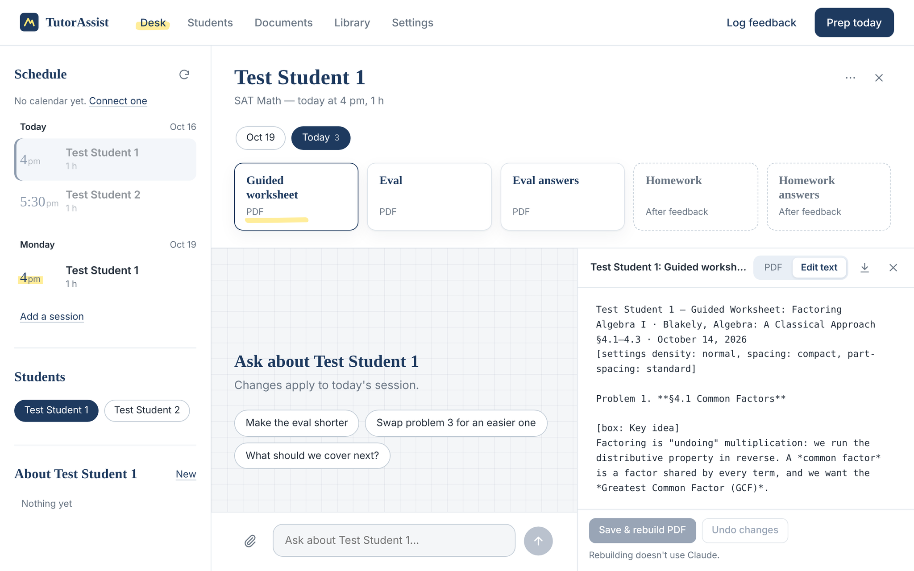
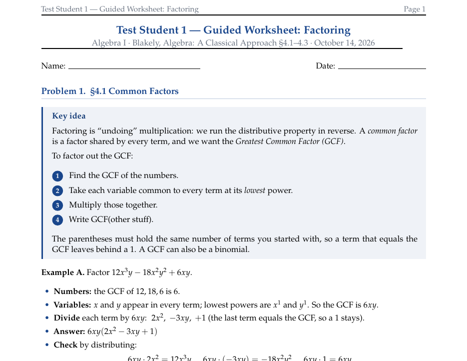

# TutorAssist

**A tutoring-prep assistant that runs on your own computer and uses your Claude account to
write each student's guided worksheet, quiz, answer keys and homework.**

Before a session, TutorAssist looks at your calendar, at what the student should cover
next, and at your own textbooks, then writes a **guided worksheet** (with a worked answer
key), an **eval quiz** and the **eval answers**. After the session you tell it how it
went (the student's answers, a few notes, or photos of their work), and it grades the
quiz, updates the student's record, and writes **homework** with its answers. Everything
stays in a folder on your computer as plain files and PDFs.



- **Prep runs by itself** every morning for that day's sessions, or with one click.
- **Click a student** to see their five documents for any session, read them beside the
  chat, download them, or ask for changes ("make problem 3 easier").
- **Fix a typo yourself:** open a document, switch to **Edit text**, and rebuild the PDF
  in a couple of seconds, without using any Claude usage.
- **Your textbooks are the source of truth.** Topics, wording and worked examples follow
  the book's own sections, and every answer is checked twice before it's written down.



---

## What you need

- **A Mac or a Linux computer.** Windows isn't supported directly (WSL may work, but it's
  untested).
- **A Claude account that can use Claude Code**: a paid
  [Claude subscription](https://claude.com/pricing) or an
  [Anthropic Console](https://platform.claude.com/) (API) account. TutorAssist runs
  Claude Code for you, so prep counts against that account's usage.
- **Your textbooks as PDFs.** Books with real text (not just scanned images) work best.
- **Optional: your tutoring calendar's private iCal link** (Google, Apple or Outlook) so
  sessions show up by themselves. You can also add sessions by hand.

You don't need to install anything else first. The installer sets up Python, Claude
Code, and LaTeX (which typesets the worksheets) if they're missing. It never asks for
your computer's admin password. LaTeX takes a few hundred MB of disk space if it has to
be installed.

## Install (about 10 minutes, once)

1. Open **Terminal** and download TutorAssist. Copy this repository's URL from the green
   **Code** button on GitHub, then run:

   ```bash
   git clone <this repository's URL> TutorAssist
   bash TutorAssist/install.sh
   ```

   No `git`? Use **Code → Download ZIP** instead, unzip it, and run
   `bash path/to/the/unzipped/folder/install.sh`.

2. **Sign in to Claude** when a browser window asks you to. It's Claude Code's own
   sign-in page; TutorAssist never sees your password or keys.

3. When the installer finishes, TutorAssist opens in your browser at
   <http://127.0.0.1:8787>. Fill in the one setup card: your name, your time zone, your
   calendar link (optional, and you can add it later), and when the morning prep should
   run.

That's it. TutorAssist now starts by itself whenever you log in. Open it any time from
**Spotlight** on a Mac (type *TutorAssist*), from that address in your browser, or by
typing `tutor` in Terminal.

The installer only fixes what's missing, so running it again is always safe. It
remembers the folder you installed from as the source for updates, so leave that folder
where it is.

## Set up your tutoring

Your students, textbooks and documents live in a folder called **`TutorAssist`** in your
home folder. You'll mostly work with them through the app.

**1. Add your textbooks.** Go to **Library → Upload textbooks** and add your PDFs. Each book
is indexed once, so Claude can search it quickly instead of reading the whole PDF. Then
give each book a short **key** under *Book keys* (like `Holt-A1`) and pick a default book
for each subject. Topics are written with that key, for example
`Holt-A1 §4-3: Rate of Change and Slope`.

**2. Add your students.** The app comes with two example students, **Test Student 1** and
**Test Student 2**, so you can see the format. Edit or delete them on the **Students** page.
Each student has:

| Field | What it's for |
|---|---|
| Subject | Sets the level (e.g. *SAT Math*, *Pre-Calculus*) |
| Homework | Whether to make homework after each session |
| Cover next session | The topics to teach next, in order (`Key §section: Topic name`) |
| Strengths / Weaknesses | A short, current picture of where the student stands |

That's all the context the agent uses. After every session it updates these fields for
you, so the record stays short and current instead of turning into a log.

**3. Connect your calendar (optional).** **Settings → Calendar**, paste the private iCal
link, and press **Test link**. Calendar events whose titles contain a student's name become
that student's sessions, and the length of the event sets how much gets prepared (about
one topic per 20 minutes). If the same calendar has other events, set *Only events
containing* to a word your tutoring events share. Where to find the link:

- **Google Calendar:** Settings → your tutoring calendar → *Integrate calendar* →
  *Secret address in iCal format*
- **Apple Calendar / iCloud:** right-click the calendar → *Share Calendar* → *Public
  Calendar*, then copy the link
- **Outlook:** Settings → Calendar → *Shared calendars* → *Publish a calendar* → copy
  the ICS link

**4. Try a prep.** Add a session by hand for Test Student 1 (on the left, under the
schedule), click it, then press **Prep**. The example students' topics come from two
books (`Holt-A1` and `Foerster-AT`), so upload those books first or change the topics
to ones from your own books.

## Everyday use

| To do this | Do this |
|---|---|
| Prep everyone on today's calendar | Nothing: it runs every morning. Or press **Prep today** |
| Prep one session, including a future one | Click the session, then **Prep** (or **⋯ → Redo prep**) |
| See a student's documents | Click the session (or the student's name) on the left. The guided worksheet, eval, answers and homework appear as tiles; earlier sessions are one click away |
| Ask for changes | Select the student, then type in the chat ("make the eval shorter"). Changes replace that session's documents instead of adding files |
| Fix a typo or a number yourself | Open the document → **Edit text** → **Save & rebuild PDF** |
| Log how a session went | **Log feedback** (top right): the student's eval answers, notes, photos of their work |
| Edit a student | **Students**, or **⋯ → Edit student** on the desk |
| Answer the agent's questions | **Questions** (the tab appears when the agent has one) |

If something stops working (for example Claude Code gets signed out), a red banner at the
top of the app shows the command that fixes it.

## Updating

From the folder you installed from:

```bash
git pull
tutor update
```

Your students, documents and settings are never touched by an update. If you've edited
the agent's rules (`~/TutorAssist/CLAUDE.md`), the new version is saved beside yours as
`CLAUDE.md.new` instead of replacing it.

## Your files

Everything is in `~/TutorAssist`:

| File or folder | What it holds |
|---|---|
| `roster.json` | Your students (edited from the **Students** page) |
| `books.json` | Book keys and the default book per subject (the **Library** page) |
| `uploads/textbooks/` | Your textbook PDFs |
| `material/YYYY-MM-DD/` | That day's PDFs: at most five per student (guided worksheet, eval, eval answers, homework, homework answers) |
| `CLAUDE.md` | The agent's rules, in plain English. You can edit them |
| `open-questions.md` | Things the agent wants you to decide |
| `.work/`, `.tutor/`, `.claude/` | Hidden working files the app manages (the worksheets' text, history, settings) |

## How it works, and your privacy

TutorAssist has no AI of its own. Each prep or chat starts your own copy of
[Claude Code](https://code.claude.com/docs/en/overview) in the background inside
`~/TutorAssist`, where it follows `CLAUDE.md` and uses three bundled skills: Worksheet
Studio's text format, a textbook index and search tool, and an SAT module writer. Claude
writes each document as plain text, and the app turns that text into a typeset PDF the
moment it's saved, then tells Claude the page layout and any mistakes to fix. Claude never
has to render or look at pages, which keeps each prep's usage down.

- **What leaves your computer:** what Claude Code sends to Anthropic while it works (your
  request, the student's roster entry, and the textbook passages it looks up), and the
  request for your calendar feed when the app refreshes your schedule. The app has no
  analytics and no server of its own.
- **Your Claude sign-in** belongs to Claude Code. The app never reads or stores it. If
  `ANTHROPIC_API_KEY` is set, Claude Code uses that key instead.
- **The app only listens on your own computer**, and it rejects requests from other
  websites. The agent can run Python and basic file commands inside the workspace;
  web access, `curl`, `sudo`, `ssh` and recursive deletes are blocked.

## Commands

| Command | What it does |
|---|---|
| `tutor` | Open the app (starts it if it isn't running) |
| `tutor update` | Install the newest version from your download and restart |
| `tutor setup` | Repair the installation (only fixes what's missing) |
| `tutor doctor --full` | Check everything, including a test worksheet |
| `tutor prep [--date YYYY-MM-DD] [--only "Name A,Name B"]` | Prep from Terminal |
| `tutor import FOLDER` | Bring in an older tutoring folder (`CLAUDE.md` + `roster.json`) |
| `tutor service uninstall` | Stop the app from starting at login |

`tutorassist` works everywhere `tutor` does.

## Troubleshooting

- **Something's off:** run `tutor doctor --full`. Each problem comes with its fix.
- **Claude Code is signed out:** run `claude auth login`, or `tutor setup`.
- **Worksheets won't build (LaTeX):** run `tutor setup`. It reinstalls whatever LaTeX
  pieces are missing.
- **Another program uses port 8787:** start the app with `TUTOR_PORT=8790 tutor`.
- **The app's log** is `~/.tutorassist/server.log`.

## Uninstall

```bash
tutor service uninstall
uv tool uninstall tutorassist
```

Your `~/TutorAssist` folder stays, so delete it yourself if you don't want your students
and documents any more.

## Running it on a server

TutorAssist is made for one tutor on one computer. To host it, see the `Dockerfile`: you
need to set `TUTOR_ACCESS_TOKEN`, put it behind HTTPS, and give each tutor their own
deployment and their own Claude sign-in or API key.

## Development

`CLAUDE.md` in this folder explains the code (it's written for working on the app with
Claude Code). To run the tests:

```bash
uv venv && uv pip install -e '.[dev]'
.venv/bin/pytest
```

The tests use a stand-in for the `claude` command, so they cost nothing. The bundled
skills are adapted copies; after improving one, re-adapt them with
`python3 scripts/vendor_skills.py /path/to/skills`.

## Credits and license

The worksheet format and PDF generator come from
[Worksheet Studio](https://github.com/homiejhan/pdfgenerator). The app's interface uses
[marked](https://github.com/markedjs/marked) (MIT) and
[DOMPurify](https://github.com/cure53/DOMPurify) (Apache 2.0 / MPL 2.0).

TutorAssist is released under the [MIT License](LICENSE).
